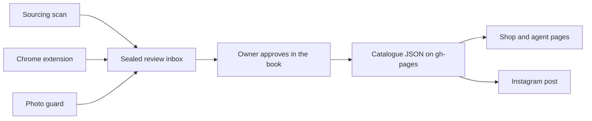

# Northline House

**Considered everyday essentials.**

Northline House is a curated fashion retailer delivering shoes, bags and clothing across Nigeria. This repository holds the live site at [northlinehouse.shop](https://northlinehouse.shop), plus the tools that run the business behind it: catalogue, sourcing, stock checks, agent sales and social posting.

Customers browse the shop and send their order on WhatsApp. Northline confirms size and delivery, and the customer pays by bank transfer after that confirmation. Independent agents sell from their own catalogue page and earn commission on paid orders.

The site is a static site on GitHub Pages. There is no application server or database: JSON files in the repo hold the data, and GitHub Actions runs the scheduled jobs.

## Pages

| Path | What it is | Who it's for |
|---|---|---|
| `shop/` | Storefront with filters, bag and WhatsApp checkout | Customers |
| `index.html` | Catalogue and sharing tools | Sales agents |
| `me/` | Agent earnings | Sales agents |
| `orders/` | Order log and sales view | Owner |
| `book/` | Private catalogue: review, prices, publishing (password-encrypted) | Owner |
| `photo-check/` | Product photo review | Owner |

## How the catalogue stays current



Nothing new goes on sale automatically. New styles wait in the review inbox until the owner approves them in the book.

## Automation

| Workflow | Runs | What it does |
|---|---|---|
| `capone-check` | Mondays for the full check, other days for photo links only | Checks listing status, photo links and sizes in stock for that brand's styles |
| `brands-check` | Mondays | Runs the weekly check across the other brands |
| `photo-guard` | Daily | Keeps store photos product-only and hides any photo that shows a person |
| `sourcing-scan` | Manual | Reads brand catalogues and queues new styles for review |
| `ig-autopost` | Daily, or manual preview | Previews or publishes the daily Instagram post |
| `photo-model-test` | On relevant pull requests, or manual | Tests the photo-classification code |
| `inbox-forward` | On pushes to `inbox.json` on `main` | Copies a misplaced review batch to the live inbox |
| `fetch-images` | On pushes to its fetch branches | Fetches supplier photos for later processing |

Instagram publishing stays in preview mode until the `IG_POSTING_ENABLED` repository variable is set to `true`.

## Repository layout

```text
index.html, shop/, book/, orders/, me/, photo-check/   site pages
*.json                                                 catalogue, price, brand and order data
brand/                                                 logos, brand sheet, packaging
tools/book/                                            source and test build for the owner's book
tools/extension/                                       "Add to Northline" Chrome extension
tools/sourcing/                                        catalogue scan, ranking, photo classification
tools/capone/, tools/brands/                           weekly stock and link checks
tools/photos/                                          product-only photo guard
tools/ig/                                              Instagram preview and posting
tools/tests/                                           Node and Python tests
.github/workflows/                                     scheduled and event-driven jobs
```

More detail: [book](tools/book/README.md), [extension](tools/extension/README.md), [Instagram](tools/ig/README.md), [brand sheet](brand/BRAND-SHEET.md).

## Run it locally

Needs Node 20+ and Python 3.11+. Most of the Python tests also need Pillow.

```bash
# Serve the site from the repo root, then open http://localhost:8080/shop/
python3 -m http.server 8080

# Build a test copy of the owner's book with made-up data
node tools/book/dev-build.mjs
python3 -m http.server 8080 -d _dev

# Run the tests
node --test tools/tests/*.mjs tools/book/*.test.mjs tools/sourcing/*.test.mjs
python3 -m unittest discover -s tools/tests -p "test_*.py"
```

The test book's password is `test`. It uses a throwaway key pair and can't save to GitHub.

## Branches and deployment

| Branch | Purpose |
|---|---|
| `main` | Code, brand files and docs |
| `gh-pages` | The live site. Scheduled jobs commit their data here |

Merging to `main` doesn't change the live site. Publishing to `gh-pages` is a separate step, decided by the owner.

## Security

- Buy prices and owner-only data are stored encrypted. The owner's book is the only thing that decrypts them.
- Review batches are sealed with a public key before they reach the repo.
- API tokens live in GitHub Actions secrets, never in the repo.
- The order log is public data, so it must never hold customer names, phone numbers or addresses.

## How it's built

Founded and run by Farouk Ahmed, who directs the work and approves every change. The code is written with AI coding agents, Claude and Codex. Their shared rules are in [AGENTS.md](AGENTS.md), and session notes are in [HANDOFF.md](HANDOFF.md).

## Trademarks

Third-party brand names and product images belong to their respective owners. Their appearance here does not imply endorsement.

## License

No open-source license has been granted. Copyright © 2026 Northline House. All rights reserved.
