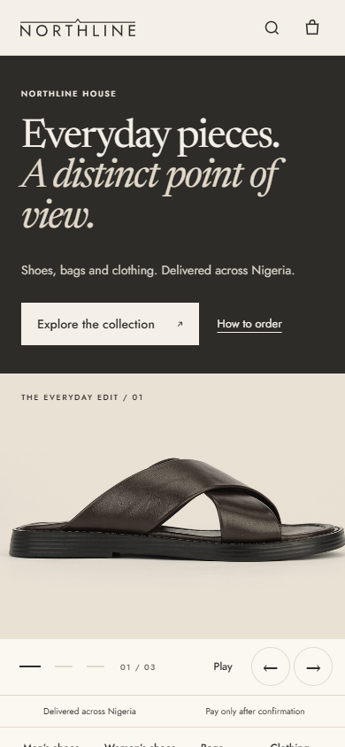
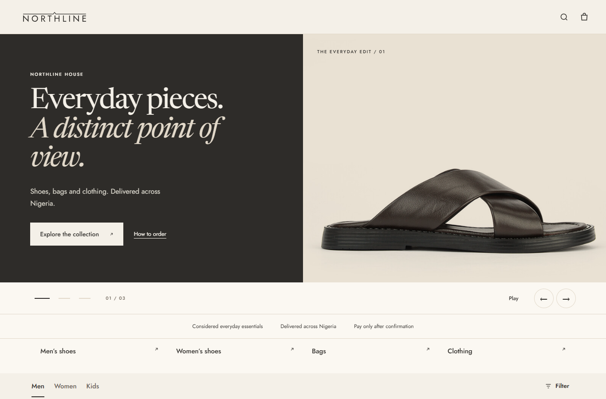
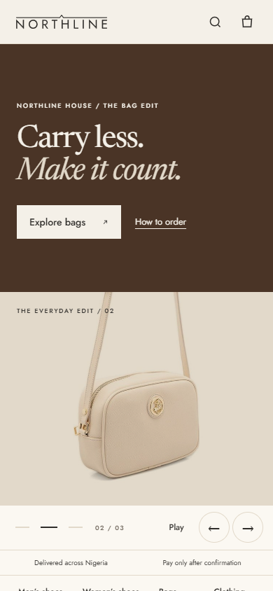
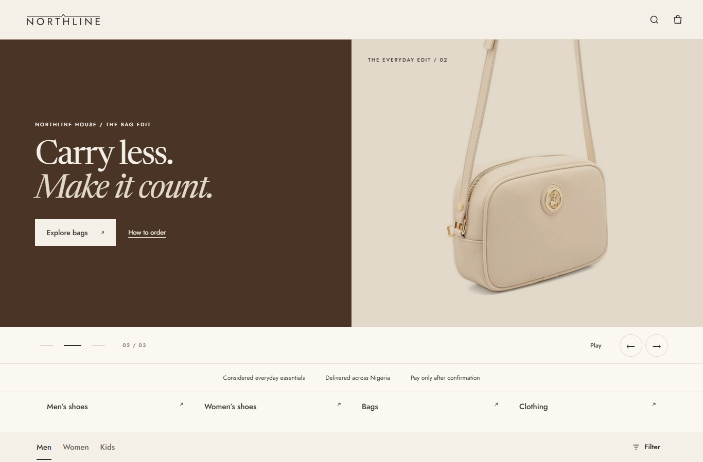
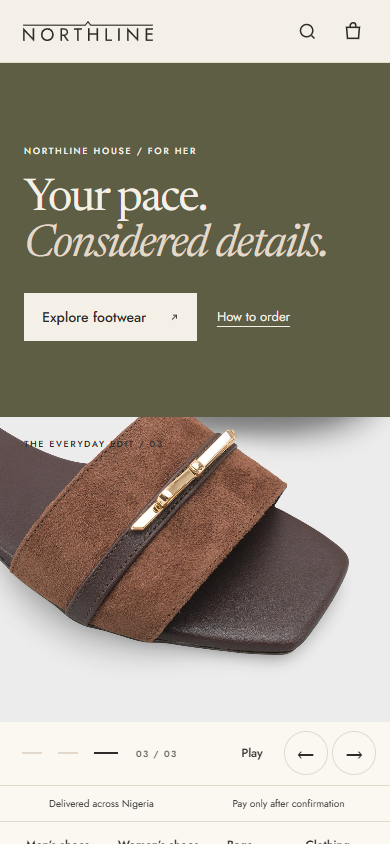
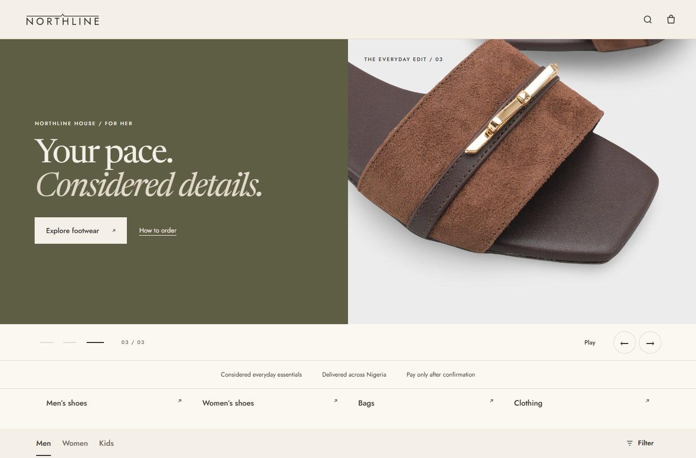

# Restored live hero — 14 November 2026

Reference: gh-pages `3ad322d5bada9a0ff95436e5ea3fc6c852659f0f`. The fixed hero markup, copy, panel styling and original product-only bag image are restored. The exact 31,883-character live NL-PHOTO-RULES block is included. Catalogue split, compact category links, robots.txt and sitemap are retained.

Screenshots use the public live catalogue and stock/price data: 982 items. An empty **test-only** hero pool exposes all three fixed fallback slides; production pool selection is unchanged. All six checks pass image loading, dark panel colours, visible order links, copy containment, slide counters, no page errors and no horizontal overflow.

The reduced mobile height was not retained: the compact attempt clipped hero photos and revealed only the top of the product tiles. These screenshots restore the live mobile proportions. The first grid row starts at about y=1099 on the 390x844 viewport, below the fold. Desktop viewport is 1366x900.

| Slide | 390px | 1366px |
|---|---|---|
| Everyday pieces |  |  |
| Bags |  |  |
| Footwear |  |  |

Repeat with `node tools/hero-restoration-check.cjs PUBLIC_SNAPSHOT SCREENSHOT_OUTPUT`. The snapshot contains shop.html (the live shop HTML), catalogue.json extracted from its base catalogue, prices.json, products.json, capone.json, brands.json, drop.json, reviews.json and photo-rules.json. The runner verifies exact live photo-rule parity before opening the browser. Set PLAYWRIGHT_MODULE to a local Playwright installation if needed; Edge is used.

Owner design decision is pending. No live data writes or deployment.
