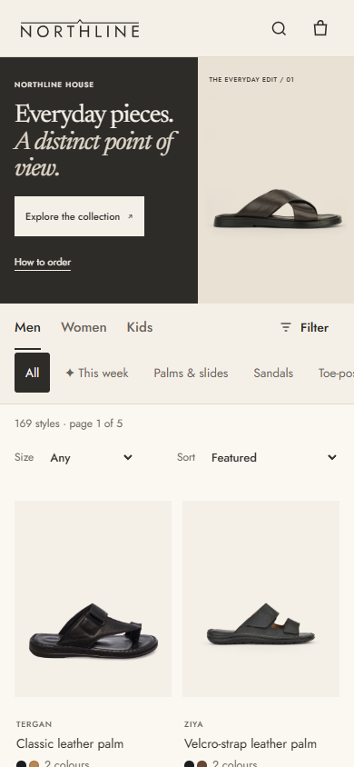
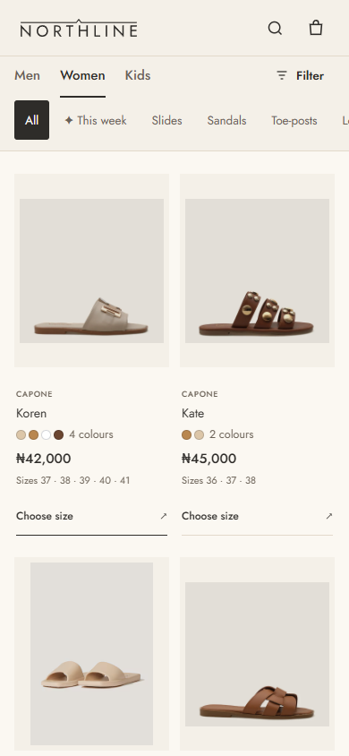
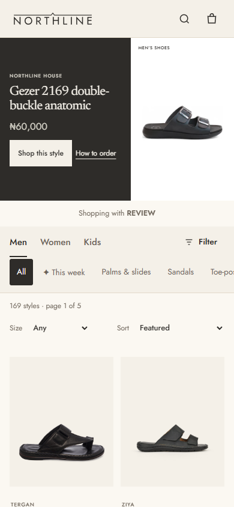
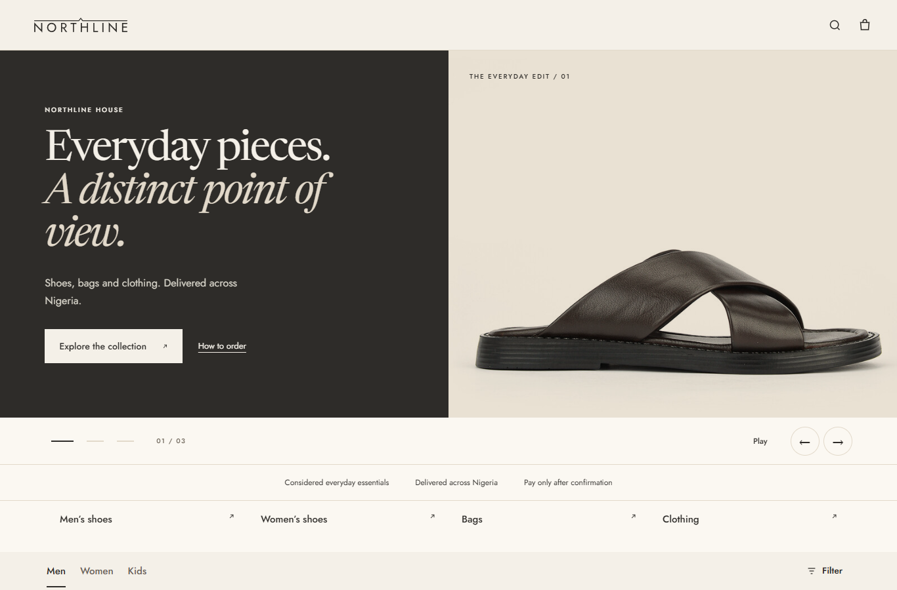
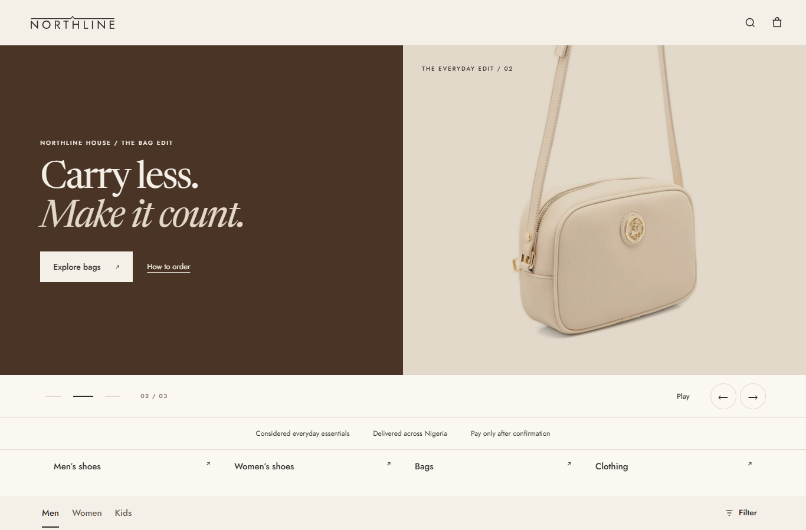
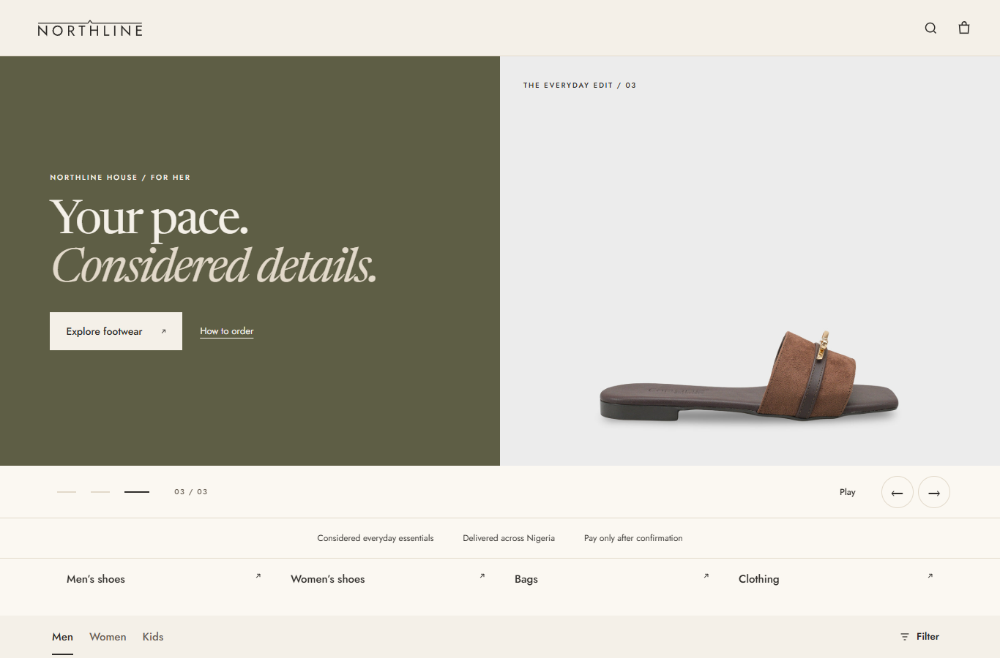

# Mobile shopping edit

Review against public gh-pages **7a56cec8bd8580e9431c80d74eb45107a5e40a3c**, with 982 priced shop items and the exact 31,883-character live NL-PHOTO-RULES block. No live files changed.

- At 390 × 844 the fixed hero stays still; the first two product photographs are visible on entry. Grid top moves from 1,098.56px to 551.02px. Desktop keeps all three slides, navigation and opt-in autoplay.
- Mobile retains the approved heading, dark panel, visual label and How to order. Its descriptive sentence and duplicate collection links are hidden to shorten the entry to browsing. Approved pools still work: the first selected men's shoe is the static mobile slide.
- Pool loading preserves the hero's reserved height at both widths. Long mobile pool headings use up to three visible lines; the complete name remains in the accessible heading and product detail.
- Cards list the lead colour's available sizes, price and Choose size (View details for one-size/sold-out styles). Stale stock says Confirm availability. Clicking the action opens the existing product detail view.
- First 36 Men/Women refs match main at both widths, recorded in the JSON report. No ranking changes.
- 182 Node tests pass; Featured, hero pool and SEO suites pass. Browser checks cover copy fit, loaded photographs, horizontal overflow, product opening and referral links. A 12-ref pool exercises the same live eligibility checks; duplicate styles rejected are recorded in the report.
- The third fixed photograph is the unchanged supplier original for CAP-922-BRN: https://cdn.shopify.com/s/files/1/0566/3732/5374/files/716-922-FDG-01-00001_K342_2.jpg?v=1789997889 . Visually checked: whole product, no model. No image editing or generation.

Run `node tools/shopping-edit-check.cjs PUBLIC_SNAPSHOT OUTPUT`. The snapshot contains public prices/products/capone/brands/drop/reviews/photo-rules JSON, live catalogue as catalogue.json and live shop HTML as shop.html. The runner uses an empty test pool for fixed slides, then a sample pool; it never publishes a pool. For baseline comparison, BASELINE=1 reads `_hero-reference/baseline-index.html`, baseline-storefront.css and baseline-storefront.js captured from main.

